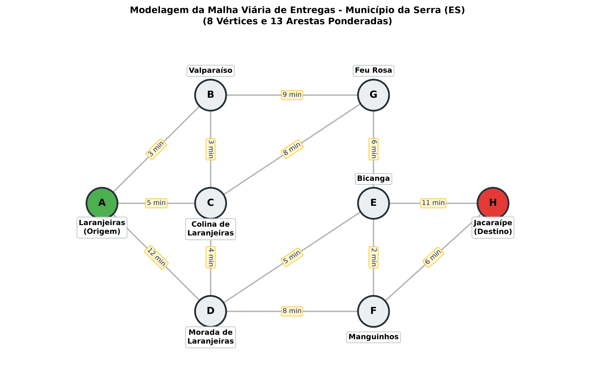
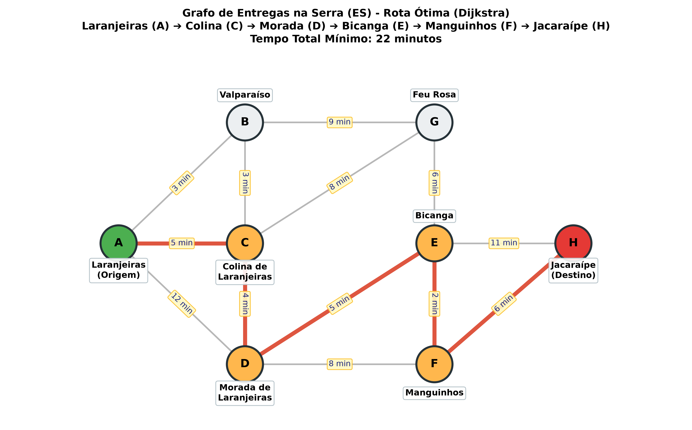

# Aplicação do Algoritmo de Dijkstra na Otimização de Rotas de Entrega de Medicamentos no Município da Serra

> **Autor:** Pedro Henrique Costa  
> **Instituição:** Instituto Federal do Espírito Santo (IFES) – Campus Serra  
> **Contato:** pedrohcosta211@gmail.com  
> **Área:** Matemática Discreta / Teoria dos Grafos / Pesquisa Operacional

---

## 📌 Resumo

A agilidade na entrega de medicamentos é um fator crítico para farmácias que atendem pedidos urgentes em áreas urbanas, onde o tempo de deslocamento impacta diretamente o atendimento e a saúde dos clientes. Este projeto apresenta a modelagem e a resolução computacional do problema de otimização de rotas de entrega de uma farmácia localizada em **Laranjeiras**, no município da Serra (ES), com destino ao bairro de **Jacaraípe**. 

A malha viária compreendendo oito bairros da região foi modelada como um grafo não-direcionado e ponderado com pesos correspondentes aos tempos médios de deslocamento em minutos. Utilizando o **Algoritmo de Dijkstra** implementado com fila de prioridade (*min-heap*), identificou-se a rota ótima com tempo total de deslocamento estimado em **22 minutos**.

**Palavras-chave:** Teoria dos Grafos, Algoritmo de Dijkstra, Otimização de Rotas, Menor Caminho, Matemática Discreta.

---

## 🗺️ Descrição do Problema e Modelagem

### Contexto Real
Uma farmácia em Laranjeiras atende pedidos de entrega rápida para bairros vizinhos e para a região litorânea da Serra (ES). O entregador (motociclista) precisa selecionar o trajeto mais rápido até o cliente em Jacaraípe em condições normais de trânsito.

### Definição dos Componentes do Grafo $G = (V, E)$
- **Vértices ($V$):** 8 bairros da Serra:
  - **A:** Laranjeiras (Ponto de partida / Farmácia)
  - **B:** Valparaíso
  - **C:** Colina de Laranjeiras
  - **D:** Morada de Laranjeiras
  - **E:** Bicanga
  - **F:** Manguinhos
  - **G:** Feu Rosa
  - **H:** Jacaraípe (Destino / Cliente)
- **Arestas ($E$):** 13 vias bidirecionais de ligação direta entre os bairros vizinhos.
- **Função de Peso ($w$):** Tempo médio estimado de deslocamento por motocicleta (em minutos).

$$w(p) = \sum_{i=1}^{k} w(v_{i-1}, v_i)$$

---

## 📊 Representações dos Dados

### 1. Lista de Adjacência

| Vértice (Bairro) | Vizinhos Adjacentes (Vértice, Tempo em min) |
| :--- | :--- |
| **A (Laranjeiras)** | (B, 3), (C, 5), (D, 12) |
| **B (Valparaíso)** | (A, 3), (C, 3), (G, 9) |
| **C (Colina de Laranjeiras)** | (A, 5), (B, 3), (D, 4), (G, 8) |
| **D (Morada de Laranjeiras)** | (A, 12), (C, 4), (E, 5), (F, 8) |
| **E (Bicanga)** | (D, 5), (F, 2), (G, 6), (H, 11) |
| **F (Manguinhos)** | (D, 8), (E, 2), (H, 6) |
| **G (Feu Rosa)** | (B, 9), (C, 8), (E, 6) |
| **H (Jacaraípe)** | (E, 11), (F, 6) |

### 2. Matriz de Adjacência (em minutos)

O valor `0` denota a ausência de aresta direta ou a distância para si próprio.

| | A | B | C | D | E | F | G | H |
|:---:|:---:|:---:|:---:|:---:|:---:|:---:|:---:|:---:|
| **A** | 0 | 3 | 5 | 12 | 0 | 0 | 0 | 0 |
| **B** | 3 | 0 | 3 | 0 | 0 | 0 | 9 | 0 |
| **C** | 5 | 3 | 0 | 4 | 0 | 0 | 8 | 0 |
| **D** | 12 | 0 | 4 | 0 | 5 | 8 | 0 | 0 |
| **E** | 0 | 0 | 0 | 5 | 0 | 2 | 6 | 11 |
| **F** | 0 | 0 | 0 | 8 | 2 | 0 | 0 | 6 |
| **G** | 0 | 9 | 8 | 0 | 6 | 0 | 0 | 0 |
| **H** | 0 | 0 | 0 | 0 | 11 | 6 | 0 | 0 |

---

## 🖼️ Representação Visual do Grafo

### Malha Viária Modelada (Figura 1 do Artigo)


### Rota Ótima com Algoritmo de Dijkstra (Figura 2 do Artigo)


---

## ⚙️ Funcionamento e Simulação Passo a Passo

O algoritmo de Dijkstra utiliza uma estratégia gulosa com complexidade $\mathcal{O}((V + E) \log V)$ via fila de prioridade (*min-heap*).

### Tabela de Rastreamento das Iterações (Origem: A $\rightarrow$ Destino: H)
Formato: `tempo acumulado (predecessor)`. O traço `—` indica que o vértice já teve seu custo definitivo confirmado.

| Passo | Vértice Visitado | A | B | C | D | E | F | G | H |
| :---: | :---: | :---: | :---: | :---: | :---: | :---: | :---: | :---: | :---: |
| **Início** | — | 0 (-) | $\infty$ | $\infty$ | $\infty$ | $\infty$ | $\infty$ | $\infty$ | $\infty$ |
| **1** | **A** | 0 (-) | 3 (A) | 5 (A) | 12 (A) | $\infty$ | $\infty$ | $\infty$ | $\infty$ |
| **2** | **B** | — | 3 (A) | 5 (A) | 12 (A) | $\infty$ | $\infty$ | 12 (B) | $\infty$ |
| **3** | **C** | — | — | 5 (A) | **9 (C)** | $\infty$ | $\infty$ | 12 (B) | $\infty$ |
| **4** | **D** | — | — | — | 9 (C) | 14 (D) | 17 (D) | 12 (B) | $\infty$ |
| **5** | **G** | — | — | — | — | 14 (D) | 17 (D) | 12 (B) | $\infty$ |
| **6** | **E** | — | — | — | — | 14 (D) | **16 (E)** | — | 25 (E) |
| **7** | **F** | — | — | — | — | — | 16 (E) | — | **22 (F)** |
| **8** | **H** | — | — | — | — | — | — | — | **22 (F)** |

### Momentos Críticos de Relaxamento:
1. **Passo 3 (ao visitar C):** A distância até D cai de 12 min (aresta direta A $\rightarrow$ D) para **9 min** (via A $\rightarrow$ C $\rightarrow$ D).
2. **Passo 6 (ao visitar E):** A distância até F é atualizada de 17 min para **16 min** (via D $\rightarrow$ E $\rightarrow$ F).
3. **Passo 7 (ao visitar F):** O tempo até o destino H é otimizado de 25 min (via E $\rightarrow$ H) para **22 min** (via F $\rightarrow$ H).

---

## 🏆 Resultados Obtidos

Reconstruindo o caminho a partir dos predecessores ($H \leftarrow F \leftarrow E \leftarrow D \leftarrow C \leftarrow A$):

$$\text{Melhor Rota: } A \rightarrow C \rightarrow D \rightarrow E \rightarrow F \rightarrow H$$
$$\text{Laranjeiras} \rightarrow \text{Colina de Laranjeiras} \rightarrow \text{Morada de Laranjeiras} \rightarrow \text{Bicanga} \rightarrow \text{Manguinhos} \rightarrow \text{Jacaraípe}$$

- **Tempo Total Estimado:** **22 minutos** ($5 + 4 + 5 + 2 + 6$)

### Comparativo com Trajetos Intuitivos

| Trajeto | Sequência de Bairros | Qtd. Bairros | Tempo Total | Diferença p/ Ótimo |
| :--- | :--- | :---: | :---: | :---: |
| **Ótimo (Dijkstra)** | **A $\rightarrow$ C $\rightarrow$ D $\rightarrow$ E $\rightarrow$ F $\rightarrow$ H** | **6** | **22 min** | **Referência** |
| Intuitivo (Menos Bairros) | A $\rightarrow$ D $\rightarrow$ F $\rightarrow$ H | 4 | 26 min | +4 min (+18,2%) |
| Alternativo via Feu Rosa | A $\rightarrow$ B $\rightarrow$ G $\rightarrow$ E $\rightarrow$ H | 5 | 29 min | +7 min (+31,8%) |

> **Conclusão:** O trajeto com menos conexões intermediárias não é o mais rápido. A modelagem matemática evita heurísticas visuais falhas e garante economia real de tempo e combustível.

---

## 🚀 Como Executar

### Pré-requisitos
- Python 3.8 ou superior.
- Para a visualização gráfica (opcional):
  ```bash
  pip install matplotlib networkx
  ```

### 1. Execução do Algoritmo de Dijkstra
```bash
python codigo.py
```

**Saída Esperada:**
```text
Melhor rota: Laranjeiras (A) -> Colina de Laranjeiras (C) -> Morada de Laranjeiras (D) -> Bicanga (E) -> Manguinhos (F) -> Jacaraípe (H)
Tempo total estimado: 22 minutos
```

### 2. Gerar Visualizações Gráficas do Grafo
```bash
python visualizar_grafo.py
```
Esse comando gera as imagens em alta resolução (`grafo_malha_viaria.png` e `grafo_rota_otima.png`), idênticas às Figuras 1 e 2 apresentadas no artigo.

---

## 📁 Estrutura do Repositório

```text
├── Artigo Matemática Discreta - Otimização de Rotas de Entrega (Dijkstra).pdf  # Artigo científico completo
├── codigo.py                                                                   # Implementação do Algoritmo de Dijkstra
├── visualizar_grafo.py                                                         # Script de plotagem do grafo (NetworkX/Matplotlib)
├── grafo_malha_viaria.png                                                      # Imagem da malha viária (Figura 1)
├── grafo_rota_otima.png                                                        # Imagem com a rota ótima destacada (Figura 2)
└── README.md                                                                   # Documentação acadêmica do projeto
```

---

## 📚 Referências

- CORMEN, T. H.; LEISERSON, C. E.; RIVEST, R. L.; STEIN, C. **Algoritmos: Teoria e Prática**. 3. ed. Rio de Janeiro: Elsevier, 2012.
- DIJKSTRA, E. W. A note on two problems in connexion with graphs. **Numerische Mathematik**, v. 1, n. 1, p. 269–271, 1959.
- MENDONÇA, P. F.; KESTRING, F. B. F.; SILVA, F. P. Um estudo sobre algoritmos para roteirização. **Revista Eletrônica Científica Inovação e Tecnologia**, v. 8, n. 18, p. e-5122, 2017.
- SILVA, D. F. Aplicação conjunta do método de Dijkstra e otimização combinatória para solução do problema do caixeiro viajante. In: **Simpósio de Excelência em Gestão e Tecnologia (SEGeT)**, VI, 2009.
- SOUSA, N. G. B.; ROSSI, A. C. Aplicação do algoritmo de Dijkstra para otimização de rotas em percursos urbanos utilizando transporte público. Universidade Presbiteriana Mackenzie, São Paulo, 2019.
- ZERMIANI, A. T.; FIDALGO, F. D. C. Uma Introdução ao Algoritmo de Dijkstra. **Proceeding Series of the Brazilian Society of Computational and Applied Mathematics**, v. 9, n. 1, 2022.

